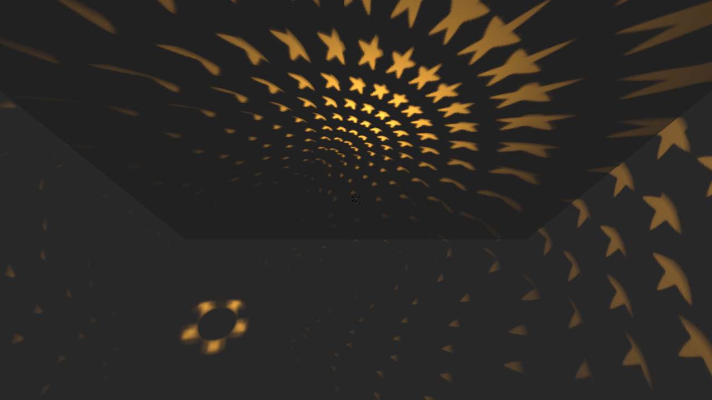

# Mirrorball user guide

> **Photosensitivity note.** On their defaults neither plugin flashes. But with a small ball,
> the pin spot in close and the ball turning fast, the spots are big patches of light sweeping
> across the picture, and each one passing is a flash: measured at up to **16 flashes' worth of
> rises and falls in a second** in a third of the picture, where the guidance draws the line at
> six (**three flashes a second**). Sync can turn the ball much faster than Free's 5 rpm. Flashing
> light can trigger seizures in people with photosensitive epilepsy. See [Flashing, and keeping
> it safe](#flashing-and-keeping-it-safe) before you put a fast, close setting in front of an
> audience.

Mirrorball is **a mirror ball and its pin spot, for [Resolume](https://resolume.com) Arena and
Avenue**, as two FFGL plugins in one download: **SW Mirrorball**, a source that is a turning
mirror ball in a dark hall full of its spots, and **SW Mirror Over**, an effect in which the same
spots land on your clip, printed on the back wall, or carry your clip as the pin spot's gobo.

Nothing in it is drawn as a spot. The ball is rings of small flat square mirrors, and one narrow
pin spot is aimed at it. A flat mirror reflects by the law of reflection and doesn't change the
beam's spread, so each spot is the pin spot seen through a small square window. For every pixel
on the walls, the floor and the ceiling, the plugin finds the few facets that could send it
light, traces each ray back through its facet to the lamp's lens and its gate, reads the gobo
for that ray, and adds them up. So close to the lamp every spot is a whole, mirrored copy of the
gobo, and further off each one carries only a piece of it; spots stretch where they land at a
slant, crowd and dim behind the ball, crawl near the axis and race toward the horizon; and a
missing facet is a hole in the pattern that turns with the ball.


*One frame of SW Mirrorball on its defaults, from the offline harness, not captured from
Resolume: a 50 cm ball of 6,452 10 mm facets, the pin spot 5 m off to the right. The ring on the
left wall is the pin spot's own light passing the ball, with the ball's shadow in it.*

> **Before you rely on this:** it's at **v0.1.0**, the first release, and early days. Everything
> below was compiled, rendered and measured offline on an Apple Silicon Mac (macOS 26), by a
> harness that drives the plugins' own classes in a headless GL context, at two rasters
> (1280×720 and 320×180) and partly on Apple's software renderer, reading linear lux straight off
> the plugins' output. It checks the optics, not screenshots. A facet's spot, caught on two
> planes, leaves at the angle it arrived to 5.6 × 10⁻⁵ rad; one facet's light summed over a plane
> is what it intercepted from the pin spot, at any distance and slant, to 2.8 × 10⁻⁴ of it; near
> the lamp each spot is the gate cone's ellipse to 7.3 × 10⁻⁴ of its area; spots on a ceiling run
> round circles at the ball's own rate to 1 × 10⁻⁴; which facets are missing is the same on the
> CPU and the GPU, spot for spot; and Sync steps start on the host's beat to 3.4 × 10⁻⁸ s.
> Eighteen models that are wrong on purpose and twenty-seven one-character changes to the shipped
> code are all caught, and every control that has pixels changes the picture.
> It has **never been loaded into Resolume**, on macOS or Windows. Both Windows DLLs build under
> MSVC and load as a host loads them, with their names, ids, types and parameters as declared.
> The facets' layout, the pin spot's lens and its brightness are assumptions (see [Known
> limits](#known-limits)). Try it on a spare layer before you put it in a show.
>
> This codebase was created with AI assistance, directed and reviewed by a human author.

---

## Installing

Every download carries both plugins: **SW Mirrorball**, a source (`Mirrorball.bundle` on macOS,
`Mirrorball.dll` on Windows), and **SW Mirror Over**, an effect (`Mirror Over.bundle`,
`Mirror Over.dll`). Drop them into Resolume's effects folder and restart Resolume:

```
macOS    ~/Documents/Resolume Arena/Extra Effects/
Windows  %USERPROFILE%\Documents\Resolume Arena\Extra Effects\
```

Avenue uses the same layout under its own folder name. SW Mirrorball appears among the sources
and SW Mirror Over in the effects browser.

The macOS download is a universal build (Apple silicon and Intel), as a `.dmg` or a `.zip`. It's
**Developer ID-signed and notarised**, so the bundles just load. The Windows download is an x64
installer or a `.zip`. The installer offers Arena's folder above, or Avenue's on a machine that
only has Avenue; change it on the folder page if you use the other one. It isn't code-signed, so
it trips SmartScreen once: **More info** → **Run anyway**. Or skip the installer and copy the two
`.dll` files out of the `.zip` into the folder by hand.

---

## Start here

1. Put **SW Mirrorball** in a clip slot and play it. The defaults are a 50 cm ball of 10 mm glass
   turning at 1 rpm, lit by a 5° pin spot 5 m away, 10° up and 75° round to the right, in a 12 m
   hall at 3% room light, seen from the front of the room.
2. Watch the spots: near the ball's axis, on the ceiling, they crawl round in circles; out toward
   the walls' far edges they streak. That's the ball's one angular rate seen at different
   distances from its axis.
3. Turn **Throw** down toward 0.5 m and the spots change kind: with the lamp in close each spot
   is a whole, mirrored copy of the gate, and with **Gobo** on **Star** every spot is a star.
4. Set **Motor** to **Sync** and the ball stops turning steadily and steps 15° on every beat of
   Resolume's tempo, gliding over half of each beat. When the transport isn't running it keeps
   its own clock at the last tempo Resolume sent (120 BPM if it never sent one).
5. For your own footage, put **SW Mirror Over** on a clip. The spots land on your clip, printed on
   the back wall; between them it's nearly dark (see Room Light below). **Clip As** **Gobo**
   puts your clip in the pin spot instead, so every spot carries a piece of it.

The defaults: Diameter 0.5 m, Facet Size 10 mm, Missing 0%, Seed 1, Motor Free, Speed 1 rpm, Step
On Beat, Step Angle 15°, Glide 0.5, Beam 5°, Throw 5 m, Elevation 10°, Bearing 75°, Gobo Open,
Colour White, Room 12 m, View Room, Room Light 0.03, Exposure 0. SW Mirror Over has no View (it
always looks at the back wall), sets Exposure +5/6 stop, and adds Clip As Surface and Mix 100%.

---

## Recipes

**The classic.** The defaults, on a dark layer. 1 rpm is the one speed of the Eurolite MD-2010,
the motor most mirror balls hang from.

**A star in every spot.** Throw near **0.5 m**, Beam **12°**, Gobo **Star**, Colour **Amber**,
Diameter **0.2 m**, Bearing **36°**. With the lamp nearer than about 1.3 m, each facet sees the
whole gate, so every spot is a complete star, mirrored. The large star on the left wall is the
lamp's own light passing the ball, with the ball's shadow in it.



*The pin spot in close: a 20 cm ball, a 12° beam 0.5 m away, the Star gobo, Amber, Bearing 36°.*

**Your clip in pieces round the room.** SW Mirror Over, Clip As **Gobo**, the lamp at the default
5 m. Far from the lamp each facet sees only part of the gobo, about a quarter of its width at the
defaults, centred on where that facet sits in the beam: your clip arrives in mirrored pieces
scattered over the wall. Bring Throw down to under about 1.3 m and every spot carries the whole
clip.

**Spots on the beat.** Motor **Sync**, Step On **Beat**, Step Angle **15°**, Glide **0.5**: the
ball turns 15° on each beat, gliding there over the first half of the beat. Glide **0** jumps;
Glide **1** moves for the whole beat. A negative Speed steps the other way. Keep Glide at 0 or
the angle small if the lamp is in close (see the next section).

**A worn ball.** Missing **20–30%**, and Seed to pick which ones. The gaps turn with the ball and
are the same in every instance and every frame, so two layers with the same Seed agree.

**Looking at the back wall.** View **Wall** (the source only) looks straight at the back wall,
the one SW Mirror Over prints your clip on, so the spots cross the frame instead of swirling.

---

## Flashing, and keeping it safe

**On its defaults neither plugin flashes.** Measured from the plugins' own output over the whole
picture and over every third-of-the-picture patch, the brightness never swings by the amounts
the guidance counts: not at the defaults, not at any Speed up to ±5 rpm with the default ball
and lamp, and not with Sync at any Step On, Step Angle and Glide tried with the default ball and
lamp, up to 90° steps on every half beat at 240 BPM, at +4 stops, on the Wall view. SW Mirror Over
at its defaults didn't flash over any of Resolume's 33 demo clips, and made the two busiest of
them calmer (6 and 5 rises and falls a second on their own, 0 through it).

**It can flash when the spots are few and big, and move fast.** A small ball (20 cm) with the pin
spot in close (about a metre or nearer) makes each spot a large patch of light, a few of them to
a third of the picture, and when they sweep past fast each one passing is a rise and a fall in
brightness. People with photosensitive epilepsy can have a seizure from flashing light, and the
line that broadcast guidance (Ofcom) and web guidance (WCAG 2.x) draw is **no more than three
flashes in any second** over a large area of the picture. A flash here is a rise and a fall in
brightness of at least a tenth of white; two make a flash, so the line is six.

Measured from SW Mirrorball's own output, rises and falls in the worst second in the worst third
of the picture, with a 20 cm ball, a 12° beam, a 6 m room, no Room Light and the Wall view (the
whole picture never went over the line in any of these):

| Motor | ball and lamp | Exposure | rises and falls |
| --- | --- | --- | --- |
| Free, 5 rpm | 10 mm facets, lamp 1.1 m | +4 | 10, **over** |
| Free, 3 rpm | 10 mm facets, lamp 1.1 m | +4 | 6, at the line |
| Free, 5 rpm | 10 mm facets, lamp 1.1 m | 0 | 0 |
| Free, 5 rpm | 14 mm facets, lamp 1.1 m | +1 | 7, **over** |
| Sync, Half Beat, Glide 0, 120 BPM, any angle 15–60° | 20 mm facets, lamp 0.5 m below | +4 | 4 at most |
| Sync, Half Beat, Glide 0, 90°, at 180 / 200 / 240 BPM | 20 mm facets, lamp 0.5 m below | +4 | 6 / 7 / 8, **over above 180** |
| Sync, Half Beat, Glide 1, 120 BPM, 15° / 20° / 90° | 20 mm facets, lamp 0.5 m below | +4 | 6 / 9 / 16, **over from 20°** |
| Sync, Half Beat, Glide 1, 90°, 120 BPM | 20 mm facets, lamp 0.5 m below | 0 | 16, **over** |
| Sync, Bar, Glide 1, 90°, 120 BPM | 20 mm facets, lamp 0.5 m below | +4 | 7, **over** |

SW Mirror Over measured the same way over Resolume's 33 demo clips: at 5 rpm with the 20 cm ball,
10 mm facets and the lamp at 1.1 m at +4 stops, 2 of the 33 went over the line (8); at its own
Exposure, +5/6 stop, those two measured 0. With the lamp 0.5 m below a 20 cm ball of 20 mm facets,
Sync on the half beat at 240 BPM, 90° steps and Glide 1 at +4 stops, 7 of the 33 went over (up to
18).

What keeps it within the guidance, in everything measured:

- **A bigger ball or the lamp further back.** With the default 50 cm ball and the lamp at 5 m,
  nothing went over the line at any setting tried.
- **In Free, Speed at 3 rpm or slower**, or **Exposure at 0 or below**.
- **In Sync, Glide 0 and no more than six steps a second.** With no glide the picture only
  changes on a step, so it can't flash faster than it steps: Half Beat up to 180 BPM, Beat up to
  360. With any glide the ball turns between steps, and Sync can turn it far faster than Free's
  5 rpm: 90° every half beat at 120 BPM is 60 rpm on average, and even 15° every half beat is
  10 rpm. With the lamp in close, keep Glide at 0, or the Step Angle small and the Step On slow.

None of this is a substitute for warning your audience. The [browser
demo](https://mirrorball-demo.stoatworks-labs.com/) opens on the defaults, which don't flash.

---

## The Ball group

| Control | Range | Default | What it does |
| --- | --- | --- | --- |
| **Diameter** | 0.2–1 m | 0.5 m | The ball's size; the slider is linear, its middle 0.6 m. |
| **Facet Size** | 5–20 mm | 10 mm | Each square mirror's side. The slider is geometric: its middle is 10 mm. Eurolite's sheets list 5 and 10 mm; 20 mm is past them on purpose. |
| **Missing** | 0–50% | 0% | Facets taken out, chosen by a hash of Seed. Each gap is a hole in the pattern that turns with the ball. |
| **Seed** | 0–999 | 1 | Which facets are missing. The same Seed gives the same gaps in every instance and every frame. |

The ball is rings of equal latitude, each with as many facets as fit, with 10% grout between
them, every facet reflecting 86% (EN 1036's floor for silvered float glass). The default ball has
6,452 facets; the 1 m ball of 5 mm glass has 103,702.

---

## The Motor group

| Control | Range | Default | What it does |
| --- | --- | --- | --- |
| **Motor** | Free, Sync | Free | Free turns at a steady Speed; Sync steps on Resolume's beat. |
| **Speed** | −5 to 5 rpm | 1 rpm | Free's rate, either way (the Stairville MBM40D runs 0.5–5 rpm). In Sync only its sign counts: the step's direction. The slider's middle is 0. |
| **Step On** | Half Beat, Beat, 2 Beats, Bar | Beat | How often Sync steps. |
| **Step Angle** | 1–90° | 15° | How far each Sync step turns the ball. The slider is geometric: its middle is about 9.5°. |
| **Glide** | 0–1 | 0.5 | How much of the step interval the move takes, on a raised cosine. 0 jumps; 1 moves for the whole interval. |

The motor runs on the plugin's own clock in double precision, so Free's phase is the same at any
frame rate, and a Sync step's instant is found inside the frame it falls in: it starts on the
beat, not on the next frame after it. The harness checks it against a host clock of
499,000,000 ms, about six days of Arena running, to 10⁻¹² of a turn.

At 1 rpm a spot 10 m from the ball moves at about 1 m/s. Every spot keeps the ball's angular
rate, so its speed is ωρ, its distance from the axis: near the axis they crawl, toward the
horizon they streak.

---

## The Spot group

| Control | Range | Default | What it does |
| --- | --- | --- | --- |
| **Beam** | 3–12° | 5° | The pin spot's beam angle (ADJ's narrow lens to its wide one; Eurolite's PST-5 is 5°). The brightness stays the same as the beam widens, so the light per facet drops. |
| **Throw** | 0.5–10 m | 5 m | The lamp's distance from the ball. The slider is geometric: its middle is about 2.2 m. |
| **Elevation** | −90° to 90° | 10° | How far above (or below) the ball's level the lamp is. −90° is straight below. |
| **Bearing** | −180° to 180° | 75° | How far round the ball the lamp is; 0 is toward the camera, positive to the right. |
| **Gobo** | Open, Dots, Ring, Star, Bars | Open | The pattern in the pin spot's gate. In SW Mirror Over, Clip As Gobo replaces it with your clip. |
| **Colour** | White, Red, Amber, Green, Cyan, Blue, Magenta | White | The lamp's colour. |

**Two kinds of spot, and Throw decides which.** The lamp is a 114 mm lens (a PAR36's) with its
gobo focused at infinity. Nearer than about 1.3 m at the default 5° beam (it's the lens width
over twice the tangent of the half-beam), each facet sees the whole gate, and every spot is a
whole, mirrored copy of the gobo. Further away a facet sees only the lens, and its spot is a
window onto the gobo, about a quarter of the gobo's width across at the defaults, centred on
where that facet sits in the beam.

**Spots stretch where they land at a slant.** A spot is a cone cut by a wall: round square-on, an
ellipse twice as long as it is wide at 60°, long thin streaks across the ceiling's far edge.

**The spill.** The part of the beam that misses the ball lands on the room with the ball's shadow
in it. A beam that just fills the ball, as the default one does, leaves a thin ring, lit only by
the edge of the lens.

---

## The Room group

| Control | Range | Default | What it does |
| --- | --- | --- | --- |
| **Room** | 6–30 m | 12 m | How wide the hall is; it's half as high. The ball hangs at three quarters of its height. |
| **View** | Room, Wall | Room | SW Mirrorball only. Room looks into the hall from the front; Wall looks straight at the back wall. |
| **Room Light** | 0–1 | 0.03 | Light on every surface besides the spots, as a fraction of white. |
| **Exposure** | ±4 stops | 0 (+5/6 in the Over) | The camera's exposure. The spots are lux off a real lamp's flux; Exposure scales them. |

The picture is linear light, clamped at white, with no tone curve: a surface shows its colour ×
(Room Light + its lux from the spots, scaled by Exposure).

---

## SW Mirror Over: your clip in the room

SW Mirror Over is the same ball and lamp seen on the back wall, with two more controls:

- **Clip As Surface** (the default): your clip is printed on the back wall and lit by the room and
  the spots. "The spots land on the clip." Where the clip is transparent there is no wall: its
  alpha comes through, and nothing under a transparent pixel shows.
- **Clip As Gobo**: your clip, cropped square, is the pin spot's gobo, so every spot carries a
  piece of it, or all of it with the lamp in close. Transparent is no light. The room is opaque
  wherever Mix shows it.
- **Mix**: 0 hands the clip straight back, untouched.

Its **Exposure default is +5/6 stop**, set from Resolume's 33 demo clips: the largest, in
sixth-stop steps, at which the spots blow no more than 1% of the median clip's spot-lit pixels
out to white. At it a spot shows the median clip at about three quarters of its own brightness.


*SW Mirror Over on its defaults, from the offline harness, with Resolume's bundled
`IntoTheGlow_02` as the clip.*

---

## How it works

For every surface pixel, the plugin works out which facet normal would send the lamp's light
there, then visits the rings and facets round it (up to ±6 of each, 169 candidates at most). It
traces each candidate's ray back by the law of reflection, asks whether it passes the lens and
the gate, reads the gobo for that ray, and adds the light with smooth coverage ramps at the
facet's edges so a spot's outline is exact without aliasing. The gobo is a small mipmapped
texture drawn first; the gate itself is applied analytically. The brightness is anchored to a
real fixture: the flux Chauvet's LED Pinspot 2 measures (4,120 lux at 2 m with its 6° lens).

The harness checks this against optics computed independently in the harness itself: equal
angles of incidence and reflection from two planes' centroids, the near-field spot against the
cone–plane ellipse, one facet's light over a plane against what it intercepted, spots on a
ceiling running round circles at the motor's rate, which piece of the gobo each spot carries and
that it is mirrored, and the missing facets against the CPU's hash.

---

## Performance

Measured by the offline harness on an Apple Silicon Mac shared with other builds, GPU time per
frame, median of 120 frames after a warm-up:

| | 720p | 1080p |
| --- | --- | --- |
| SW Mirrorball, the defaults | 0.67 ms | 1.21 ms |
| SW Mirrorball, View Wall | 0.53 ms | 1.19 ms |
| SW Mirrorball, 1 m ball of 103,702 facets, lamp in close | 3.18 ms | 6.84 ms |
| SW Mirror Over, the defaults (Surface) | 0.54 ms | 1.21 ms |
| SW Mirror Over, Gobo | 0.62 ms | 1.37 ms |
| SW Mirror Over, 1 m ball of 103,702 facets, lamp in close | 3.38 ms | 7.79 ms |

The cost grows with the number of facets a pixel has to visit: a big ball of small facets with a
wide beam in close is the worst case. Nothing was timed inside Resolume, at 4K, or on Windows.

---

## If it looks wrong

**The ball doesn't turn.** In Free, Speed is at its middle (0 rpm). In Sync, Speed only sets
the direction; the steps follow Resolume's tempo, or the plugin's own clock at the last tempo it
was sent, and a Step Angle near 1° barely moves it.

**The clip is nearly black in SW Mirror Over.** That's the room: Room Light is 3% of white, so
between the spots there's almost no light. Raise Room Light to see the clip between them.

**The spots are blown white.** Exposure is up, or the lamp is in close with a narrow beam. Turn
Exposure down to see the gobo in them.

**My clip isn't in the spots.** Clip As is Surface by default: the clip is the wall. Set Clip As
to Gobo, and bring Throw down to see the whole clip in each spot.

**The spots look like smudges, not squares.** The lamp is far and the beam narrow, so each facet
sees only the lens and the spot is a window onto the gobo; with an Open gobo that's a soft round
patch. That's how a real pin spot on a mirror ball looks.

**Spots near the top of the frame are long streaks.** They're landing on the ceiling at a
grazing angle, as they do in a real hall.

**The plugin draws nothing.** That's what a shader that won't compile looks like. The log has the
error:

```
macOS    ~/Library/Logs/mirrorball/mirrorball.YYYY-MM-DD.log
Windows  %LOCALAPPDATA%\mirrorball\logs\mirrorball.YYYY-MM-DD.log
```

---

## Known limits

- **Never loaded into Resolume**, on macOS or Windows: nothing is known yet about how it looks in
  a composition, how Arena's beat drives Sync, or how it performs there.
- **SW Mirror Over's default Clip As is Surface**, not Gobo. Under Gobo at the defaults each spot
  carries a disc of your clip about a quarter of its width, so the picture is lost in tinted dots;
  with the lamp in close every spot carries the whole clip. Which should be the default is open.
- **Room Light 0.03 leaves your clip nearly black between the spots** in SW Mirror Over. That's
  a dark hall; raise it if you want the clip to read.
- **The two plugins' Exposure defaults differ**: 0 in SW Mirrorball, +5/6 stop in SW Mirror Over,
  where it was set from Resolume's demo clips.
- **The grout is an assumption.** The facets have 10% grout between them, which takes 17% of the
  light, though the manufacturers' sheets describe their balls as gapless. No sheet gives a facet
  count or arrangement; the rings and their offsets are this project's.
- **The cap.** A pixel visits at most 169 candidate facets. With very wide, grazing spots (the
  biggest balls with the lamp in close) the far side of each spot is dropped: 0.77% of the light
  at the worst setting.
- **The pin spot is two fixtures.** Its flux is Chauvet's LED Pinspot 2's, its lens a PAR36's
  diameter. The lens is uniformly bright, the gate hard and the focus at infinity: a real lamp's
  falloff toward the beam's edge isn't modelled.
- **Perfect tiles.** Every facet is flat and exactly aligned: no tilt scatter, no chipped or dull
  tiles, no wobble on the motor.
- **No air and no bounce.** No beams are seen, only spots on surfaces, and walls don't light
  walls. The room is an empty box with chosen surface colours.
- **It can flash** with a small ball, the lamp in close and a fast spin (see above).
- **The inspector shows slider positions**, not metres or degrees. This guide gives the ranges and
  where the middle of each slider is.
- **No presets** and no OpenFX version.

---

## About

The last group, **About**, has the plugin's name, version, licence and maker, and buttons that
open the project page, this user guide, the source on GitHub and the support page in your
browser.

## Links

- Project page: [stoatworks-labs.com/software/mirrorball](https://stoatworks-labs.com/software/mirrorball/)
- Source: [github.com/stoatworks-labs/mirrorball](https://github.com/stoatworks-labs/mirrorball)
- User guide: [stoatworks-labs.com/software/mirrorball/guide](https://stoatworks-labs.com/software/mirrorball/guide/)
- Browser demo: [mirrorball-demo.stoatworks-labs.com](https://mirrorball-demo.stoatworks-labs.com/)

## Reporting something

If something's wrong, shout at
[github.com/stoatworks-labs/mirrorball/issues](https://github.com/stoatworks-labs/mirrorball/issues).
A screenshot, which plugin, the Motor, Throw and Clip As settings, and the log are usually
enough.
